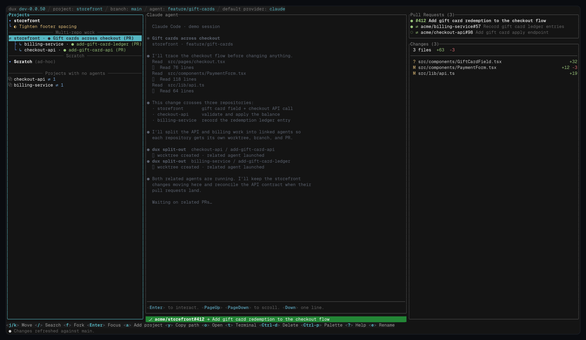

# dux

<p align="center">
  
  
  
  
  
  
</p>


`dux` is a terminal UI for orchestrating multiple AI coding agents, each project agent in its own git worktree, plus ad-hoc scratch agents that are not attached to a project, with live agent terminals, companion terminals, macros, commit generation, and a command palette.

This repository is a personal fork of [patrickdappollonio/dux](https://github.com/patrickdappollonio/dux). The original package was great, but I needed a few more workflow features to use it as my day-to-day agent manager. This fork is intended to be installed from source rather than through upstream release channels.

<br clear="right" />

<p align="center">
  
</p>

<p align="center">
  <a href="https://asciinema.org/a/IvqL89rXvwCzvSxQ">Watch the asciicast demo</a>
</p>

## Table Of Contents

- [Overview](#overview)
- [Status](#status)
- [Delegated Worktrees](#delegated-worktrees)
- [Documentation](#documentation)
- [Install](#install)
- [Prerequisites](#prerequisites)
- [Development Setup](#development-setup)

## Overview

| Icon | Item | Details |
| --- | --- | --- |
| 🖥 | Interface | Terminal UI with projects and agents, live agent output, changed files, and diffs |
| 🌿 | Worktrees | One isolated git worktree per project agent, with fork and existing-worktree workflows |
| ⇄ | Delegated work | Agents can delegate work into linked worktrees in the same repo or another project; the origin agent moves into this section with its delegation tree |
| ✦ | Scratch | Always-visible ad-hoc agents that run in their own folders with the diff pane hidden, and can be converted into projects later |
| 🤖 | Providers | Any CLI through a PTY; Claude, Codex, and OpenCode by default |
| 🧰 | Workflow | Companion terminals, macros, queued diff comments, AI commit messages, and worktree PR tracking with stacked-PR detection |
| 🎨 | Configuration | Fully commented config, rebindable keys, and a theme engine |
| 🧪 | Validation | `cargo fmt`, Clippy, unit tests, and PTY integration tests |

## Status

`dux` currently supports macOS and Linux, with Windows users expected to run it through WSL2. The app is under active development as a personal fork.

Recent fork additions include:

- Copy and paste between agent and terminal panes.
- A searchable project and agent sidebar that narrows the tree as you type.
- A searchable existing-worktree picker for creating or reconnecting agents.
- Cleanup for inactive managed worktrees and unreferenced scratch workspaces.
- An always-visible Scratch workspace for ad-hoc agents, with the diff pane hidden and conversion into a new project or an existing project's worktree.
- Always-visible diffs against the base branch, with easy rebasing.
- Queued comments on selected diff lines that can be sent back to an agent.
- OpenCode session resume and discovery.
- Cross-pane macros with short descriptions, auto-created targets, optional Enter submission, background delivery badges, and configurable focus.
- Delegated worktrees: an agent can delegate work into a linked worktree in the
  same repository or another project, wait for a structured result, and collect
  the child's changes.

## Delegated Worktrees

An agent running inside dux can delegate work to a child agent:

```bash
"$DUX_BIN" agent delegate \
  --repo /path/to/other-repo \
  --name fix-api-contract \
  --title "Fix the API contract" \
  --brief-file - \
  --json
```

Use `--same-repo` instead of `--repo`/`--project` to branch from the parent
agent's own repository. The default same-repo base is the parent's HEAD; use
`--base-mode leading` for the project leading branch or
`--base-mode parent-snapshot` to include the parent's uncommitted files.

Dux creates the worktree, launches the child agent with a brief that points at a
durable task file, and links the child to the parent. The child reports back
with:

```bash
"$DUX_BIN" agent finish --status success --summary-file - <<'DUX'
What changed, how it was verified, and anything the parent must know.
DUX
```

The parent can then inspect the tree and result, wait for completion, or ask for
another iteration:

```bash
"$DUX_BIN" agent status --json
"$DUX_BIN" agent wait --all --timeout 100 --json
"$DUX_BIN" agent result --delegation <id> --json
"$DUX_BIN" agent followup --delegation <id> --text-file -
```

A `wait` timeout exits with code 2 and is not a failure; call it again to keep
polling. `blocked` children exit 4 and need a follow-up answer. `cancel` keeps
the worktree; `retry` is for failed launches; `integrate` merges a completed
same-repo child into its parent. The command palette also exposes
`cancel-delegation` and `integrate-delegation` for the selected child.

The target repo can already be a dux project, or dux can register it
automatically. Set `[agent_control] allow_unregistered_repos = false` in
`config.toml` if agents should only target projects you have added manually.
Delegation limits live under `[orchestration]`; set
`[agent_control] enabled = false` or `[orchestration] enabled = false` to
disable agent-initiated changes.

Agent control uses a user-only local socket at `<config_dir>/dux.sock`. The
socket is not an agent protocol; it only lets the `dux` CLI request workspace
changes from the running TUI.

The screenshot at the top of this README is generated by the reproducible
[multi-repo demo](demo/multi-repo/README.md). Run `make screenshots` after UI
changes to refresh it.

### Agent Skill

Dux ships optional skills that teach agents how and when to delegate work:

```text
skills/dux-split-out/SKILL.md    # one cross-repo child
skills/dux-orchestrate/SKILL.md  # fan out, wait, follow up, integrate
```

Copy them into the global skill directory of the agent you use. For example:

```bash
mkdir -p ~/.config/opencode/skills/dux-split-out
cp skills/dux-split-out/SKILL.md ~/.config/opencode/skills/dux-split-out/SKILL.md
mkdir -p ~/.config/opencode/skills/dux-orchestrate
cp skills/dux-orchestrate/SKILL.md ~/.config/opencode/skills/dux-orchestrate/SKILL.md
```

OpenCode also discovers `~/.claude/skills` and `~/.agents/skills`. The skills are
not installed automatically. Run `dux agent --help` for the authoritative
command reference.

## Documentation

User and setup documentation:

- [User Guide](docs/user-guide.md)
- [Configuration](docs/configuration.md)

## Install

Clone the repository and install the binary from source:

```bash
git clone https://github.com/dflaten/dux.git
cd dux
cargo build --release
mkdir -p ~/.local/bin
install -m 755 target/release/dux ~/.local/bin/dux
```

Make sure `~/.local/bin` is on your `PATH`, then run:

```bash
dux
```

On first launch, dux creates a fully commented config file. That file is the documentation for every setting.

## Prerequisites

- **`git`** — dux is built around git worktrees, so git is non-negotiable.
- **Rust and Cargo** — required to build this fork from source.
- **`gh` CLI** *(optional)* — authenticate it with your GitHub account and dux can pull PR statuses, check details, and show them in the interface.

## Development Setup

Recommended local tools:

- Stable Rust toolchain with Cargo
- `git`
- Optional: `gh` for PR tracking

Common commands:

```bash
cargo build
cargo run
cargo fmt --check
cargo clippy --all-targets --all-features -- -D warnings
cargo test
```

To refresh the README screenshot after UI changes, run `make screenshots`. It
requires `tmux` and Python 3 with Pillow; see
[`demo/multi-repo/README.md`](demo/multi-repo/README.md) for details.

For an interactive smoke test, run `cargo run`.
